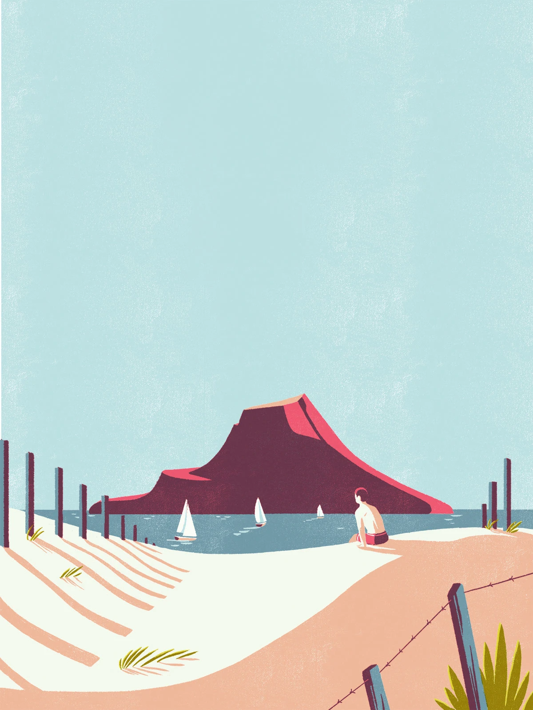
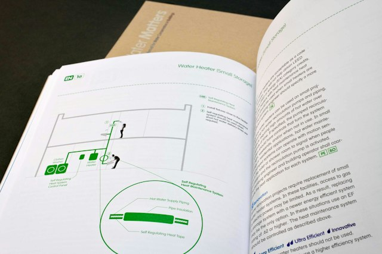
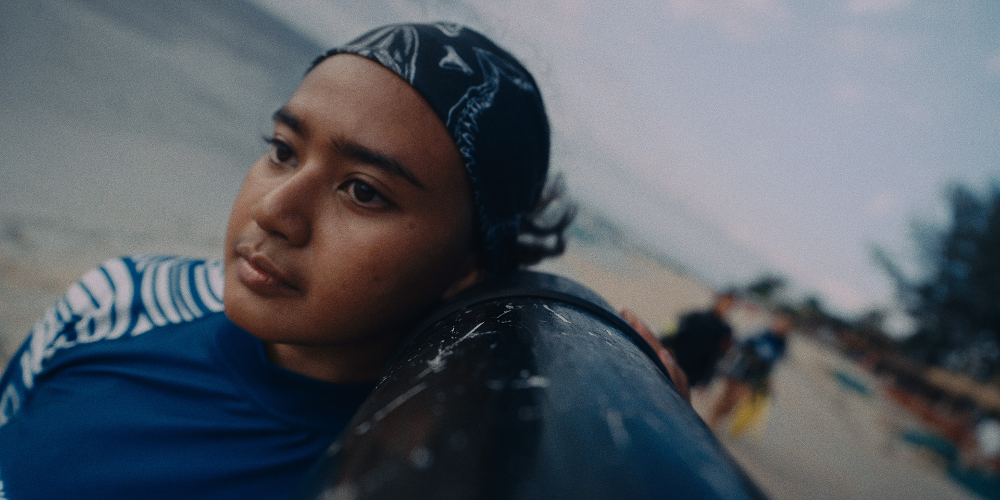

# Referensi desain natural

Ditinjau 20 Oktober 2026. Gambar di bawah dilihat langsung dan disertai sumber. Catatan penerapannya merupakan interpretasi desain untuk OWC-DESAL. Karya sumber hanya untuk tinjauan referensi, tidak dimasukkan ke komposisi video.

## Ruang pesisir dan skala manusia

**Tom Haugomat, Air France magazine.**

[Portofolio proyek](https://www.behance.net/gallery/31744057/Air-France-magazine). Halaman mendapat HTTP 403 pada pengambilan otomatis, tetapi gambar CDN karya berhasil diambil dan diperiksa. [Profil pembuat](https://www.behance.net/tomhaugomat) dan [contoh karya terbitan KIBLIND](https://kiblind-atelier.com/products/tom-haugomat-bretagne) membantu menelusuri atribusi dan bahasa bentuknya.

Yang relevan: bidang lanskap saling menutup untuk memberi kedalaman, siluet organik yang jelas, serta manusia yang menjelaskan skala. Bentuk pagar dan bayangan ikut membangun ruang. Fokus gambar terbaca tanpa label atau pola teknis.

Terjemahkan prinsip ruangnya pada pantai dan fasilitas yang dirancang sendiri. Jangan menyalin gunung merah, perahu, karakter atau komposisi sumber. Mesin memerlukan detail fungsi lebih jelas daripada objek poster. Karya Bretagne menjadi pembanding bentuk, tetapi bidang gelapnya tidak menjadi dasar tema revisi.

## Diagram teknis yang ramah dibaca

**Pentagram untuk NYC Department of Design and Construction, Water Matters.**

[Case study pembuat](https://www.pentagram.com/work/water-matters) dan [manual asli NYC DDC](https://www.nyc.gov/html/ddc/downloads/pdf/pubs/water_matters.pdf).

Case study membahas diagram untuk menjelaskan sistem air. Spread yang diperiksa menunjukkan jalur antarbagian dan anotasi di bidang terang. Ambil kejelasan alur dan hubungan peralatan dengan label. Batasi teks pada hal yang sedang dinarasikan; kepadatan buku dan ukuran huruf kecilnya tidak dibawa ke film. Ini referensi komunikasi visual, bukan sumber angka konsumsi atau standar layanan Indonesia.

## Orang dan lingkungan pesisir Indonesia

**Studio Birthplace / Frames of Change, Coral Catch: To Love and Protect.**

[Halaman karya dan kredit](https://www.studiobirthplace.com/work/coral-catch).

Film membahas komunitas perempuan dalam restorasi terumbu Indonesia. Still yang diperiksa memberi perhatian pada orang dan kegiatan dengan konteks lingkungan nyata. Ambil pelajaran penempatan manusia dan kegiatan spesifik. Untuk OWC-DESAL, petugas dan pengguna fasilitas perlu mempunyai peran yang terlihat.

Eksposur lebih gelap, wajah tokoh, footage dan lokasi tidak diambil untuk animasi. Tokoh referensi tidak digambarkan sebagai operator atau penerima manfaat project ini.

## Arah hasil seleksi

Pilih ilustrasi lingkungan pesisir yang terang, diagram editorial yang jelas, dan kegiatan manusia yang spesifik. Palet, fasilitas dan shot akhir dibuat untuk OWC-DESAL. Detailnya ada di [visual-direction.md](visual-direction.md).

Gambar referensi bukan bank aset siap pakai atau izin penggunaan ulang. Tidak ada gambar sumber yang dirujuk dari `index.html` ataupun `compositions/`.
